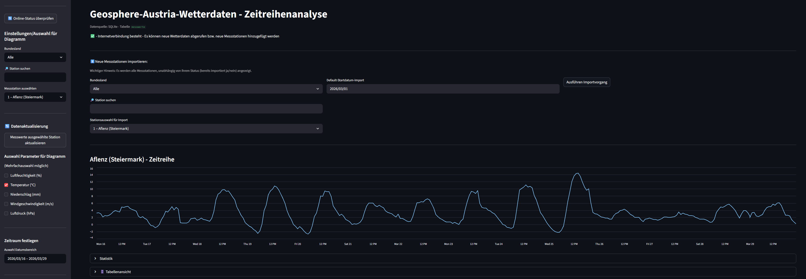
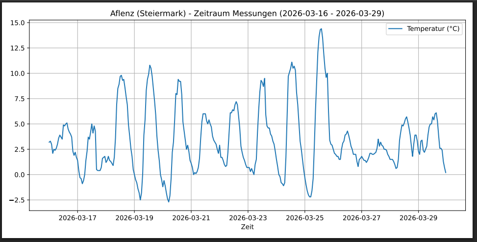

# GeoSphere Austria Wetter-App – Zeitreihenanalyse

Abschlussprojekt meines Diplomlehrgangs **„Software Developer in Python“** (WIFI Oberösterreich, 2026).

Die App ruft stündliche Messwerte österreichischer Wetterstationen automatisiert über die öffentliche API von **GeoSphere Austria** ab, speichert sie lokal in einer **SQLite-Datenbank**, bereitet sie in einem kleinen **ETL-Prozess** auf und stellt sie im Browser als interaktive Zeitreihe mit Statistik dar.



## Funktionen

- Auswahl von Messstationen, filterbar nach Bundesland und per Suche
- Import neuer Messstationen und ihrer historischen Messwerte über die API
- Automatische und manuelle Aktualisierung der Messwerte (inkrementell, nur neue Zeitstempel)
- Zeitreihendiagramm für mehrere Parameter: Temperatur, Luftfeuchtigkeit, Niederschlag, Windgeschwindigkeit, Luftdruck
- Filter nach Zeitraum
- Statistische Auswertung und Tabellenansicht der Messwerte
- Export des Diagramms als PDF und der Messwerte als Excel (bzw. CSV)
- Prüfung der Internetverbindung, damit die App auch offline mit den gespeicherten Daten nutzbar bleibt



## Datenfluss (ETL)

1. **Extract:** Abruf der Rohdaten je Station, Parameter und Zeitstempel über die GeoSphere-API (`klima-v2-1h`)
2. **Load (Rohdaten):** Speicherung in der Tabelle `messwerte_raw`
3. **Transform:** Zusammenführen zu einem Datensatz pro Station und Zeitstempel mit allen Parametern in der Tabelle `messwerte`, dazu eine SQL-View `vw_messwerte`
4. **Visualisierung:** Auswertung und Darstellung mit Streamlit, pandas und matplotlib

## Tech-Stack

- Python 3.13
- Streamlit (Benutzeroberfläche im Browser)
- pandas (Datenaufbereitung)
- SQLite (lokale Datenbank)
- requests (API-Zugriff)
- matplotlib (Diagramm-Export)

## Projektstruktur

```
├── weather_app/
│   ├── app.py            # Streamlit-Oberfläche
│   ├── pipeline.py       # API-Client und ETL-Prozess
│   ├── db.py             # Datenbankzugriff (SQLite)
│   ├── services.py       # Hilfsfunktionen (Export, Internetprüfung, Stationsauswahl)
│   ├── config.py         # zentrale Konfiguration
│   └── requirements.txt
├── weather_datas_db.db   # SQLite-Datenbank mit Stationsliste und Beispieldaten
└── docs/                 # Screenshots
```

## Installation und Start (Windows)

```bash
git clone https://github.com/py-Alti/geosphere_weather-app.git
cd geosphere_weather-app

python -m venv .venv
.venv\Scripts\activate
pip install -r weather_app/requirements.txt

python -m streamlit run weather_app/app.py
```

Die App öffnet sich anschließend im Browser unter `http://localhost:8501`.

## Datenquelle

Messdaten: [GeoSphere Austria Data Hub](https://data.hub.geosphere.at/), Datensatz „Messstationen Stundendaten v2“.
